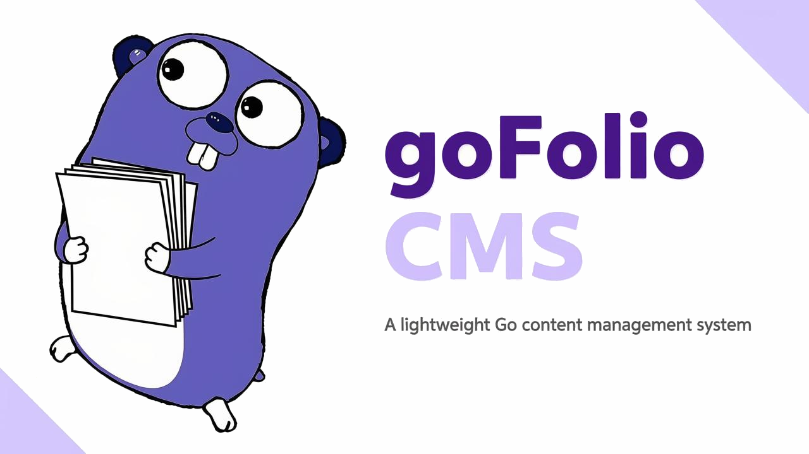

# goFolio CMS

A lightweight, self-hosted content management system written in Go.

## Overview

goFolio is a minimal content management system built with simplicity as the guiding principle. It serves a public site with posts and pages, and provides an admin panel for managing content, all backed by a single SQLite database. There is no JavaScript framework, no external database server, and no configuration ceremony: build the binary, point it at a directory, and it runs.

The public side exposes published posts and pages as JSON. The admin side offers a dashboard, a post editor, page management, and settings, protected by session-based authentication.

## Getting started

Requirements are Go 1.26 or newer and, for building inside containers only, Docker. SQLite support is compiled in through the `mattn/go-sqlite3` driver, so a C toolchain is needed to build (gcc and musl on Alpine, gcc or clang elsewhere).

To run locally:

```sh
make run
```

This builds and starts the server on port 8080, creates `gofolio.db` in the working directory if it does not exist, applies migrations, and ensures a default administrator exists. To build a release binary:

```sh
make build
./gofolio
```

To run the full test suite, including unit and integration tests:

```sh
make test
```

## Configuration

The server reads its configuration from environment variables, all of which have sensible defaults for local development.

| Variable        | Default          | Purpose                                    |
|-----------------|------------------|--------------------------------------------|
| `PORT`          | `8080`           | Port the HTTP server listens on            |
| `DOMAIN`        | `localhost`      | Domain shown in the startup message        |
| `DATABASE_PATH` | `./gofolio.db`   | Path to the SQLite database file           |
| `AUTH_SECRET`   | generated        | Secret key for session cookies             |

In production, set `AUTH_SECRET` explicitly; otherwise a random value is generated at startup, which invalidates all sessions on every restart. Sessions are cookie-based with a 24 hour lifetime.

## First login

A default administrator is created on first boot with the username `admin` and the password `admin123`. Change this password immediately after the first login. The startup log prints a reminder as well.

## Running with Docker

A multi-stage `Dockerfile` builds a static binary and ships it in a minimal Alpine image. The container stores its database under `/app/data`, which should be mounted as a volume so content survives restarts:

```sh
docker-compose up --build -d
```

The image exposes port 8080 and includes a health check that probes the `/healthz/` endpoint, which verifies both process liveness and database reachability.

## Project structure

The repository follows the layout described in detail in [docs/folder-structure.md](docs/folder-structure.md). Application entry points live under `cmd/server`. Domain logic is organised in `internal`, split into `core` for routing, `handler` for HTTP endpoints and middleware, `service` for business rules, `model` for data structures, and `store` for persistence. Shared reusable utilities live in `pkg`. Admin and public themes, including their stylesheets, are under `web/themes`. Integration tests live in `test/integration`.

## Security notes

Passwords are hashed with bcrypt. Session cookies are marked HttpOnly. Authentication for the admin panel is enforced by middleware on every admin route. The application is suitable for small, self-hosted deployments; anyone exposing it publicly should review the session cookie `Secure` flag, which is currently disabled pending HTTPS deployment.

## Credits

The Gopher character featured in the banner is based on the Go mascot, designed by Renée French and used under the Creative Commons 3.0 Attributions license. 

The admin rich-text editor is TinyMCE, © Ephox Corporation / Tiny Technologies, Inc., released under GPLv2+, self-hosted under the same GPL terms as this project.

## License

goFolio CMS is free software: you can redistribute it and/or modify it under the terms of the GNU General Public License as published by the Free Software Foundation, either version 3 of the License, or (at your option) any later version.

This program is distributed in the hope that it will be useful, but WITHOUT ANY WARRANTY; without even the implied warranty of MERCHANTABILITY or FITNESS FOR A PARTICULAR PURPOSE. See the GNU General Public License for more details. A full copy of the license is available at [https://www.gnu.org/licenses/](https://www.gnu.org/licenses/).
